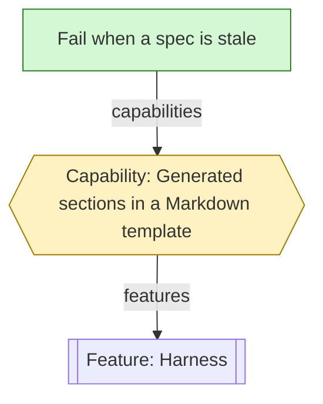

<!-- Title: what the change does, in plain words. -->

## What changed

Use structure before prose:
1. A flow is a small Mermaid diagram.
2. A set of commands, options, cases or mappings is a table.
3. Decisions taken are a table with the columns Decision, Choice and Reason, 1 row per decision.
4. Prose carries only what no table or diagram carries.

Example of a decisions table:

| Decision | Choice | Reason |
|---|---|---|
| Section header | No version in the header | A version bump must not make every spec stale. |

-

## Requirement graph

The affected part of `requirements/graph` only: the nodes this pull request adds, changes or removes, and their direct neighbours. Not the whole graph. Every change of behaviour starts with its requirement nodes (see `CLAUDE.md` and `CONTRIBUTING.md`). A pull request that changes no node writes "None." here, with no diagram, and says why below.

Conventions:
1. The diagram shows graph nodes only: features, capabilities, requirements and decisions. A condition and a test are never boxes. They go in the Acceptance conditions table below. No file and no path is a box or a label.
2. Labels are short, about 3 to 7 plain words, and never the node id. A feature label starts with "Feature:", a capability with "Capability:" and a decision with "Decision:". A requirement has no prefix.
3. Draw 1 small diagram per topic of the pull request. Write a bold title line `**<topic in plain words>**` directly above each Mermaid block. No subgraph.
4. Label each edge with its relation name from `requirements/profile.yaml`: `products`, `features`, `capabilities` or `governs`.
5. Colour by change with exactly these 3 classes: `new` for an added node, `changed` for a changed node and `removed` for a removed node. A linked node that the pull request does not change has no class. No other `classDef` and no `style` line.
6. Use `flowchart TD` in each diagram.
7. Each box has a short key, such as `rS`, and 1 binding line `%% <key>: <node-id>` that names its node id. GitHub does not render a `%%` line.
8. The shape of a box shows its node kind:
   - Feature: subroutine box `f[["Feature: …"]]`.
   - Capability: hexagon `c{{"Capability: …"}}`.
   - Decision: parallelogram `d[/"Decision: …"/]`.
   - Requirement: plain box `r["…"]`.
9. At most 4 boxes in a row. Stack a wider row with invisible links `a ~~~ b`.

Replace this illustrative example:

**Stale specs**

## Acceptance conditions

Every acceptance condition this pull request delivers or changes. A condition without a passing test is not delivered. A condition that only a real browser or device can prove is `partial`, with its note.

| Requirement | Condition id | Condition (verbatim from the node) | Test that proves it (file: it title) | Status | Result |
|---|---|---|---|---|---|
| req- | | | `test/…`: … | verified | pass |

## Surface changes

Each user-visible item that this pull request adds, changes or removes, with the requirement that names it. Write "None." if the surface does not change.

| Surface | Item | Change | Requirement |
|---|---|---|---|
| CLI command or flag | | added | req- |
| MCP tool or resource | | | |
| Profile key | | | |
| App control | | | |
| Site page | | | |

## Dependencies

Each dependency that this pull request adds, removes or changes, with its exact version and licence, and whether it ships (runtime or bundled) or is a build or test tool. Write "None." if no dependency changes.

| Package | Version | Licence | Ships or tool | Why |
|---|---|---|---|---|
| | | | | |

## Breaking changes

What a profile author, a graph author or a user of the CLI, the MCP server or `@semspec/core` must change. Write "None." if nothing breaks.

## Gates

Each gate line reads "<gate>: <result> at <head sha>", with the head sha of the pull request (7 or more hex characters), or "<gate>: not run: <reason>". Run the gates again after every push and write the new head sha. The pre-push hook runs the same gates.

- typecheck: <result> at <head sha>
- tests: <result> at <head sha>
- build: <result> at <head sha>
- semspec check (requirements): <result> at <head sha>
- semspec spec --check (docs): <result> at <head sha>
- licences: <result> at <head sha>
- site tests: <result> at <head sha>
- browser check: none, or what was checked, in which browser, at which width

Each commit carries a DCO `Signed-off-by` line (`git commit -s`).
