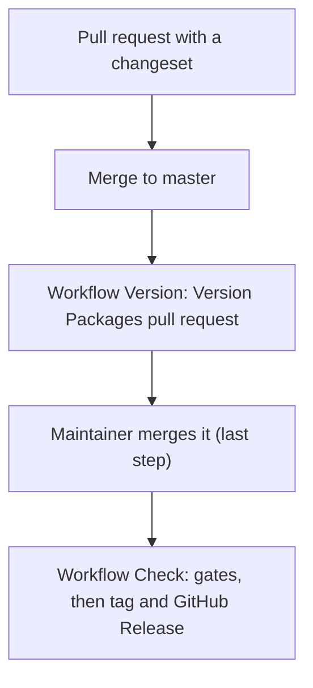

This guide is for maintainers. A release has 3 steps. The packages `semspec` and `@semspec/core` always have the same version. The packages `app`, `cli`, `mcp` and the site are private. They get no version and no tag.

## 1. Add a changeset in each pull request

Run `npx changeset` and choose `@semspec/core` and the bump. The command writes a Markdown file in `.changeset/`. The file holds the bump and the release note. Write the note for a user, in short sentences.

| Change | Bump |
|---|---|
| Fix, no change of behaviour | patch |
| New feature, backward compatible | minor |
| Break for a profile author, a graph author or a user of the CLI, the MCP server or `@semspec/core` | major |
| Nothing for a user (docs, tests, CI) | `npx changeset add --empty` |

A user-facing change in `app`, `cli` or `mcp` puts its bump on `@semspec/core`. These packages are private, and `@semspec/core` carries the version of both public packages.

A pull request of Dependabot needs no changeset. The job Changeset is skipped when the author is `dependabot[bot]`.

The job Changeset in CI runs `node scripts/check-changeset.mjs origin/<base>`. It fails when the pull request adds no changeset file, also when only a private package changes. Then it runs `npx changeset status --since=origin/<base>` to check the format. The pull request template has a Release section. Name the file and the bump there.

## 2. The Version Packages pull request

After each merge to master, the workflow Version runs `npm run version`. The script runs `changeset version` and then `scripts/sync-version.mjs`. The result is 1 pull request, "Version Packages". It does these things:

1. It raises the version of `@semspec/core`.
2. It sets the version of `semspec` (the root `package.json` and `package-lock.json`) to the same value.
3. It writes the release notes into `packages/core/CHANGELOG.md`.
4. It removes the changeset files.

The workflow commits through the GitHub API, so the commits show as verified. It never pushes to master and never makes a tag. Each new merge updates the same pull request.

A pull request that the workflow opens with the default token does not start the workflow Check. Push an empty commit to its branch or close and reopen it, so the gates run before you merge.

## 3. Merge the Version Packages pull request

Merge the Version Packages pull request. This is the last step of a person. The merge is a push to master, so the workflow Check runs. No person makes a tag.

## 4. What the workflow Check does

The job Release of the workflow Check runs after every gate job passes on the merge commit: licences, typecheck, build, tests, `semspec check`, `semspec spec --check`, site tests and the changeset job (which is skipped on a push). A failed gate stops the release.

1. The job reads the version of `package.json`. It stops with an error when `semspec` and `@semspec/core` have different versions.
2. When the tag `v<version>` exists in the repository or on origin, the job stops with a note and makes nothing. This is the case for each push to master that is not a version merge.
3. Otherwise the job writes the section of the version from `packages/core/CHANGELOG.md` and runs `gh release create` with it. The command makes the tag on the merge commit and the GitHub Release.

Only this job has the permission `contents: write`. No workflow starts on a tag push. In short, no person makes a tag.

## Repository setting

The owner turns on 1 setting once: Settings > Actions > General > "Allow GitHub Actions to create and approve pull requests". Without it, the workflow Version cannot open the Version Packages pull request.
