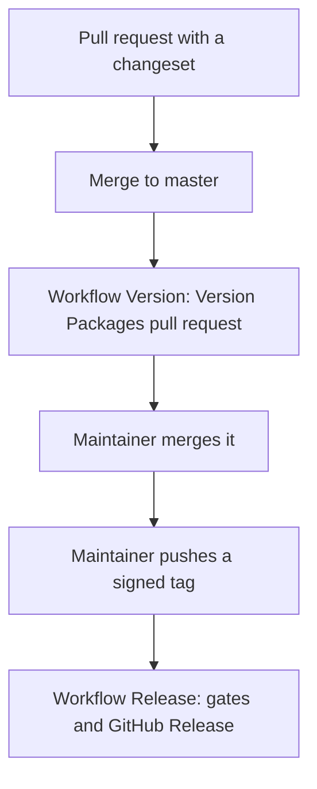

This guide is for maintainers. A release has 4 steps. The packages `semspec` and `@semspec/core` always have the same version. The packages `app`, `cli`, `mcp` and the site are private. They get no version and no tag.



## 1. Add a changeset in each pull request

Run `npx changeset` and choose `@semspec/core` and the bump. The command writes a Markdown file in `.changeset/`. The file holds the bump and the release note. Write the note for a user, in short sentences.

| Change | Bump |
|---|---|
| Fix, no change of behaviour | patch |
| New feature, backward compatible | minor |
| Break for a profile author, a graph author or a user of the CLI, the MCP server or `@semspec/core` | major |
| Nothing for a user (docs, tests, CI) | `npx changeset add --empty` |

A user-facing change in `app`, `cli` or `mcp` puts its bump on `@semspec/core`. These packages are private, and `@semspec/core` carries the version of both public packages.

The job Changeset in CI runs `node scripts/check-changeset.mjs origin/<base>`. It fails when the pull request adds no changeset file, also when only a private package changes. Then it runs `npx changeset status --since=origin/<base>` to check the format. The pull request template has a Release section. Name the file and the bump there.

## 2. The Version Packages pull request

After each merge to master, the workflow Version runs `npm run version`. The script runs `changeset version` and then `scripts/sync-version.mjs`. The result is 1 pull request, "Version Packages". It does these things:

1. It raises the version of `@semspec/core`.
2. It sets the version of `semspec` (the root `package.json` and `package-lock.json`) to the same value.
3. It writes the release notes into `packages/core/CHANGELOG.md`.
4. It removes the changeset files.

The workflow commits through the GitHub API, so the commits show as verified. It never pushes to master and never makes a tag. Each new merge updates the same pull request.

A pull request that the workflow opens with the default token does not start the workflow Check. Push an empty commit to its branch or close and reopen it, so the gates run before you merge.

## 3. Merge, pull and sign the tag

Merge the Version Packages pull request. Then run these commands, with the version that the pull request wrote:

```
git checkout master
git pull
git tag -s v0.2.0 -m "v0.2.0"
git push origin v0.2.0
```

Tag the merged commit. Use `-s`, so the tag is annotated and signed. A lightweight tag fails the release.

## 4. What the workflow Release checks

The push of a tag `v*` starts the workflow Release. It stops at the first failed step.

| Step | Stops when |
|---|---|
| Annotated tag | The tag is a lightweight tag. |
| Signature | The tag object has no `-----BEGIN SSH SIGNATURE-----` or PGP signature block. |
| Key | The file `.github/allowed_signers` exists and `git tag -v` rejects the key. |
| Tag on master | The tagged commit is not on master. |
| Version | The tag is not `v` plus the version in `package.json`, or `semspec` and `@semspec/core` differ. |
| Gates | Any gate of the workflow Check fails: licences, typecheck, build, tests, `semspec check`, `semspec spec --check`, site tests. |
| Notes | `packages/core/CHANGELOG.md` has no section for the version. |

Then the workflow runs `gh release create` with that section as the text of the GitHub Release.

The workflow cannot check the key of a signature without a list of allowed keys. To turn on the key check, add `.github/allowed_signers` (the format of `ssh-keygen -Y verify`) with the public keys of the maintainers. Without the file, the workflow checks only that a signature exists.

## Repository setting

The owner turns on 1 setting once: Settings > Actions > General > "Allow GitHub Actions to create and approve pull requests". Without it, the workflow Version cannot open the Version Packages pull request.
